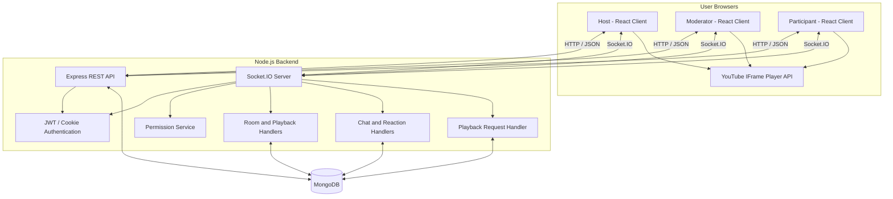

# WatchParty — Architecture Overview

## 1. System Overview

WatchParty is a client-server application that lets multiple users watch a YouTube video together in a shared room. The frontend uses React and Vite. The backend uses Node.js, Express, and Socket.IO. MongoDB stores room information, participant records, and chat messages. The YouTube IFrame Player API renders and controls the video in each browser.

The application uses two communication paths:

- **REST API (HTTP/JSON):** Guest sessions, room creation/joining, room metadata, and chat-history retrieval.
- **Socket.IO:** Room membership, playback synchronization, participant and role updates, chat messages, emoji reactions, and playback request/approval events.

## 2. High-Level Architecture

Each browser has its own YouTube player. The backend validates actions and distributes authoritative room state or playback events. Each client applies the received state to its own player.

## 3. Main Backend Components

| Component | Responsibility |
|---|---|
| Express application and routes | HTTP endpoints for authentication, room operations, and chat history. |
| Authentication middleware | Verify the signed JWT using the configured cookie or supported authorization header. |
| Socket authentication middleware | Verify the connecting socket's identity before it can participate in room events. |
| Room controller and room service | Create/retrieve rooms, manage membership and metadata, and coordinate persistent room state. |
| Permission service | Check whether a Host, Moderator, or Participant may perform an action. |
| Playback handler | Validate playback commands and distribute playback state changes. |
| Role handler | Handle role assignment, participant removal, and Host transfer. |
| Request handler | Receive participant playback requests and process Host/Moderator approval or rejection. |
| Chat handler | Process room messages, including sanitization and rate limiting. |
| Reaction handler | Validate and broadcast emoji reactions to users in the same room. |

## 4. Data Storage

The project README documents these MongoDB models/collections:

- **Room:** Room metadata and playback-related state, including the current video and playback information.
- **Participant:** A user's membership and role in a room. The documented composite index is `{ roomId: 1, userId: 1 }`.
- **Message:** Chat messages associated with a room.

Room and participant records support persistent rooms and participant/role restoration. Chat messages are persisted so room chat history can be retrieved through the REST API.

Host transfer is documented as using MongoDB transactions. The database deployment must support transactions (for example, a replica-set deployment); a standalone MongoDB server may not support this operation.

## 5. Authentication and Authorization Flow

1. A browser obtains a guest session through the authentication endpoint.
2. The backend issues a signed JWT. The README documents an HttpOnly cookie named `wp_token` and a Bearer-token header fallback.
3. REST requests and Socket.IO connections are authenticated by the backend.
4. The server derives the user's identity from the verified token rather than trusting a role or user identity supplied in an event payload.
5. Before processing a protected socket event, the backend checks the user's membership and role using the permission service.

The frontend uses role information to display or disable controls, but the backend remains the authority for permission checks.

## 6. Room Join and Leave Flow

### Joining a room

1. The user creates a room or opens a room invitation/code.
2. The frontend calls the relevant REST endpoint to establish or retrieve room membership.
3. The authenticated browser connects to Socket.IO and emits `join_room` for that room.
4. The server validates the session and room membership, joins the socket to the room channel, and sends the initial `sync_state` payload.
5. The frontend uses the returned room data, role, participant list, pending requests, and playback information to initialize the room UI.

### Leaving or disconnecting

1. The client emits `leave_room` when the user explicitly leaves.
2. The server removes the socket from the room channel and updates online presence.
3. The server broadcasts updated participant information through `user_left`.
4. A disconnected socket is handled by the server's disconnect/presence logic as well.

## 7. Real-Time Playback Synchronization

1. A Host or Moderator uses the playback controls in the React client.
2. The client emits a Socket.IO event such as `play`, `pause`, `seek`, or `change_video`.
3. The backend authenticates the socket, validates room membership and role, and validates the event payload.
4. If authorized, the backend updates the room's authoritative playback state and broadcasts the relevant playback event to the room.
5. Each connected browser receives the event and applies the corresponding action to its YouTube IFrame player.
6. The documented periodic synchronization event can be used by clients to correct playback drift and recover current room state.

Unauthorized playback commands from Participants should be rejected by the backend. Disabled frontend controls are a usability measure, not the security boundary.

## 8. Participant Request and Approval Flow

Participants cannot directly execute protected playback commands. Instead:

1. A Participant submits a request to play, pause, seek to a timestamp, or change the video.
2. The backend validates the requester and request payload, then notifies the room's Host and Moderators.
3. A Host or Moderator approves or rejects the request.
4. On approval, the backend validates the approver's permission and applies the requested playback action through the normal authoritative playback flow.
5. On rejection, the request status is updated and the requester is notified; the room playback state is not changed.

## 9. Roles and Permissions

| Action | Host | Moderator | Participant |
|---|:---:|:---:|:---:|
| Watch synchronized video | Yes | Yes | Yes |
| Play, pause, seek, or change video | Yes | Yes | Request only |
| Approve or reject playback requests | Yes | Yes | No |
| Rename room | Yes | No | No |
| Promote/demote participants | Yes | No | No |
| Remove participants | Yes | No | No |
| Transfer Host | Yes | No | No |
| Send chat messages and reactions | Yes | Yes | Yes |

The room creator becomes Host. Users joining an existing room are Participants by default. The Host can promote a Participant to Moderator. The README documents Host transfer as a transaction-backed operation, with the previous Host becoming a Participant.

## 10. Chat and Emoji Reactions

- **Chat:** A client sends a message through the chat socket event. The backend validates and sanitizes the content, applies rate limiting, persists the message, and broadcasts it to the room. The REST API can retrieve previous room messages.
- **Emoji reactions:** A client sends a reaction event. The backend validates and rate-limits the event, then broadcasts the reaction to room members for display in the video interface. The README documents reactions as real-time broadcasts; it does not describe reaction-history persistence.

## 11. Deployment Topology

The README's deployment plan separates the frontend and backend:

- **Frontend:** React/Vite application deployed on Vercel.
- **Backend:** Express and Socket.IO server deployed on Render.
- **Database:** MongoDB Atlas.

The frontend is configured with the backend API URL and Socket.IO URL. The backend is configured with the MongoDB connection string, JWT secret, production environment, and allowed frontend origin. The deployed backend must allow the frontend origin and support persistent WebSocket connections.

## 12. Operational and Security Notes

- Configure a strong, private JWT secret in the hosting provider's environment settings. Never commit real secrets or production `.env` values to GitHub.
- Keep the frontend's allowed origin and backend CORS configuration aligned with the deployed frontend URL.
- Use a MongoDB deployment that supports transactions for Host transfer.
- Test room creation/joining, playback synchronization, roles, request approvals, chat, reactions, reconnection, and Host transfer against the deployed application—not only on localhost.
- This document explains the design documented in the project's README. Actual behavior and performance should be confirmed through code review and production testing.
